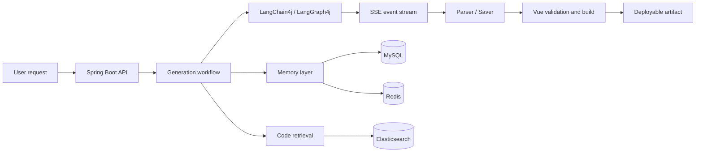

<h1 align="center">
  AI Application Generation &amp; Delivery Platform
</h1>

<p align="center">
  <sub><a href="README.md">中文</a> · English</sub>
</p>

<p align="center">
  <a href="https://github.com/glyahh/ai-generate-code"></a>
  
  
  
  
</p>

<p align="center"><strong>From natural-language requirements to previewable, editable, buildable and deployable web applications.</strong></p>

<p align="center">Java · Spring Boot · LangChain4j · LangGraph4j · Redis · Elasticsearch · Vue</p>

---

## Overview

An AI application generation and delivery platform built with Java, Spring Boot, LangChain4j and LangGraph4j.

The system turns an application description into project code, then parses, stores, retrieves, validates, builds and publishes the result as an accessible web artifact.

The project focuses on the engineering problems after code generation: preserving project context across turns, keeping Memory and `AiService` consistent after personalization changes, streaming tool events reliably over SSE, validating generated Vue code, and reusing existing project code during later generations.

## Features

<table>
<tr><td width="50%" valign="top">

### Streaming generation

Streams model text, tool requests and tool results over SSE. Supports both the standard generation path and LangGraph4j workflows.

<a href="docs/engineering-journal/cases/04-streaming-tool-state-machine.md">Engineering note →</a>

</td><td width="50%" valign="top">

### Stateful conversations

MySQL stores complete history, Redis stores the model context window, and summaries plus versioning control long conversations.

<a href="docs/engineering-journal/cases/05-layered-memory-lifecycle.md">Engineering note →</a>

</td></tr>
<tr><td width="50%" valign="top">

### Project-aware generation

Indexes code chunks in Elasticsearch and combines KNN with BM25 retrieval to reuse relevant project context.

<a href="docs/engineering-journal/cases/06-rag-artifact-retrieval.md">Engineering note →</a>

</td><td width="50%" valign="top">

### Build validation

Vue projects go through SFC parsing, repair, a second validation pass and `npm run build` before publishing.

<a href="docs/engineering-journal/cases/07-vue-build-validation.md">Engineering note →</a>

</td></tr>
<tr><td width="50%" valign="top">

### Tool execution stream

Handles partial and complete callbacks, duplicate events, empty-stream retries and state replay.

</td><td width="50%" valign="top">

### Visual editing

Supports element selection and editing in generated pages. The parent page takes over hover and selected overlays when iframe injection is unstable.

<a href="docs/engineering-journal/cases/01-iframe-visual-editor-fallback.md">Engineering note →</a>

</td></tr>
<tr><td width="50%" valign="top">

### Personalization consistency

Synchronizes MySQL, Redis, Memory Version and cached `AiService` instances after style changes.

<a href="docs/engineering-journal/cases/02-personalization-memory-consistency.md">Engineering note →</a>

</td><td width="50%" valign="top">

### Artifact delivery

Publishes parsed and stored results as static resources addressed by `deployKey`, with deployment rollback support.

</td></tr>
</table>

## Architecture



## Technology stack

| Layer | Technologies |
| --- | --- |
| Backend | Java 21, Spring Boot, Spring Web, Spring AOP |
| AI orchestration | LangChain4j, LangGraph4j, Reactor |
| Storage | MySQL, Redis, Caffeine, Redisson |
| Retrieval | Elasticsearch, KNN, BM25 |
| Frontend | Vue 3, TypeScript, Vite |
| Build and delivery | Maven, Vue compiler, static artifact publishing |

## Getting started

Requirements: Java 21, MySQL, Redis and an available OpenAI-compatible model endpoint.

Configuration: `src/main/resources/application.yml`. Keep credentials in environment variables or an untracked local configuration file.

Start the backend:

```bash
./mvnw spring-boot:run
```

The default port is `8124` and the API prefix is `/api`.

Start the frontend:

```bash
cd ai-generate-code-frontend
npm install
npm run dev
```

## API examples

| Method | Endpoint | Description |
| --- | --- | --- |
| GET | `/api/chat/gen/code` | Streaming code generation |
| GET | `/api/chat/gen/workflow` | Workflow-based generation |
| POST | `/api/app/add` | Create an application |
| POST | `/api/app/deploy` | Deploy an application |
| POST | `/api/app/undeploy` | Remove a deployment |
| GET | `/api/static/{deployKey}/**` | Access deployed resources |

## Engineering notes

The engineering journal in [`docs/engineering-journal/`](docs/engineering-journal/README.md) records the main implementation decisions and failure cases, including iframe editing, Memory consistency, tool streaming, RAG and build validation.

## Current status

The main generation, Memory, retrieval, build validation and deployment paths are implemented. Automated SSE and Memory tests, connection-pool and Redis failure tests, retrieval evaluation and repeatable load-test scripts are still being expanded.

The repository does not publish unmeasured throughput or production-availability claims.

## License

MIT
