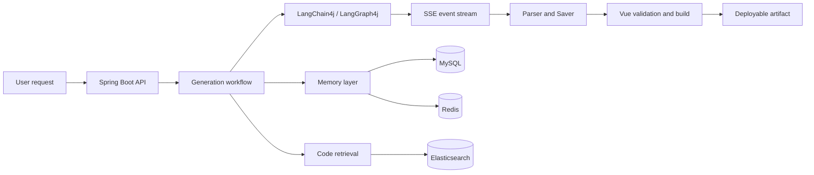

<h1 align="center">
  AI Application Generation &amp; Delivery Platform
</h1>

<p align="center">
  <a href="https://github.com/glyahh/ai-generate-code">
    
  </a>
  
  
  
  
</p>

<p align="center">
  <strong>从自然语言到可预览、可修改、可构建、可发布的 Web 应用。</strong>
</p>

<p align="center">
  Java · Spring Boot · LangChain4j · LangGraph4j · Redis · Elasticsearch · Vue
</p>

---

## Overview

这是一个 AI 应用生成与交付平台。

系统接收用户对应用的描述，通过模型和工作流生成项目代码，再经过解析、保存、检索、构建检查和发布，最终形成可以访问的 Web 应用制品。

项目关注的不只是模型能不能写出代码，还包括生成之后的几个问题：

- 多轮对话如何保持项目上下文；
- 用户配置变化后，Memory 和 AI Service 如何保持一致；
- 工具调用如何通过 SSE 稳定传递；
- 生成的 Vue 代码如何进行构建验收；
- 已有代码如何被检索并重新用于后续生成。

## Features

<table>
<tr>
<td width="50%" valign="top">

### Streaming generation

通过 SSE 返回模型文本、工具请求和工具执行事件。

支持普通生成链路和 LangGraph4j 工作流链路。

<a href="docs/engineering-journal/cases/04-streaming-tool-state-machine.md">工程记录 →</a>

</td>
<td width="50%" valign="top">

### Stateful conversations

使用 MySQL 保存完整历史，Redis 保存模型上下文窗口，并通过摘要和版本机制控制长对话成本。

<a href="docs/engineering-journal/cases/05-layered-memory-lifecycle.md">工程记录 →</a>

</td>
</tr>

<tr>
<td width="50%" valign="top">

### Project-aware generation

将生成代码切块后写入 Elasticsearch，结合 KNN 和 BM25 检索已有项目内容，减少重复生成和无关上下文。

<a href="docs/engineering-journal/cases/06-rag-artifact-retrieval.md">工程记录 →</a>

</td>
<td width="50%" valign="top">

### Build validation

Vue 项目在发布前经过 SFC 解析、问题修复、二次检查和 `npm run build`。

构建失败时不会直接进入发布流程。

<a href="docs/engineering-journal/cases/07-vue-build-validation.md">工程记录 →</a>

</td>
</tr>

<tr>
<td width="50%" valign="top">

### Tool execution stream

对工具请求进行结构化处理，支持 partial / complete 回调、重复事件过滤、空流重试和状态回放。

</td>
<td width="50%" valign="top">

### Visual editing

支持在生成页面中选择元素并进行可视化编辑。iframe 内部注入失败时，由父页面接管 hover 和 selected overlay。

<a href="docs/engineering-journal/cases/01-iframe-visual-editor-fallback.md">工程记录 →</a>

</td>
</tr>

<tr>
<td width="50%" valign="top">

### Personalization consistency

用户修改应用风格或回答风格后，同步更新 MySQL、Redis、Memory Version 和缓存中的 `AiService`。

<a href="docs/engineering-journal/cases/02-personalization-memory-consistency.md">工程记录 →</a>

</td>
<td width="50%" valign="top">

### Artifact delivery

生成结果经过解析和保存后，通过 `deployKey` 提供静态资源访问，并支持应用发布与撤回。

</td>
</tr>
</table>

## Architecture



## Request flow

```text
User request
    -> application and session context
    -> model or workflow execution
    -> text and tool events over SSE
    -> code parsing and saving
    -> project retrieval
    -> validation and build
    -> artifact deployment
```

## Technology stack

| Layer | Technologies |
| --- | --- |
| Backend | Java 21, Spring Boot, Spring Web, Spring AOP |
| AI orchestration | LangChain4j, LangGraph4j, Reactor |
| Storage | MySQL, Redis, Caffeine, Redisson |
| Retrieval | Elasticsearch, KNN, BM25 |
| Frontend | Vue 3, TypeScript, Vite |
| Build and delivery | Maven, Vue compiler, static artifact deployment |

## Getting started

### Requirements

- Java 21
- MySQL
- Redis
- An available OpenAI-compatible model endpoint

### Configuration

The main configuration file is:

```text
src/main/resources/application.yml
```

Use local environment variables or an untracked local configuration file for credentials.

### Start the backend

```bash
./mvnw spring-boot:run
```

The default server port is `8124` and the API prefix is `/api`.

### Start the frontend

```bash
cd ai-generate-code-frontend
npm install
npm run dev
```

## API examples

| Method | Endpoint | Description |
| --- | --- | --- |
| GET | `/api/chat/gen/code` | Streaming code generation |
| GET | `/api/chat/gen/workflow` | Workflow-based generation |
| POST | `/api/app/add` | Create an application |
| POST | `/api/app/deploy` | Deploy an application |
| POST | `/api/app/undeploy` | Remove a deployment |
| GET | `/api/static/{deployKey}/**` | Access deployed resources |

## Engineering notes

工程记录位于 [`docs/engineering-journal/`](docs/engineering-journal/README.md)，包含 iframe 编辑、Memory 一致性、工具流、RAG 和构建验证等案例。

- [Engineering journal](docs/engineering-journal/README.md)
- [Interview cards](docs/engineering-journal/interview-cards.md)
- [Linux lab](docs/engineering-journal/linux-lab.md)
- [Tool stream extension](docs/engineering-journal/cases/03-langchain4j-tool-stream-extension.md)
- [Streaming state machine](docs/engineering-journal/cases/04-streaming-tool-state-machine.md)

## Current status

主要生成、Memory、检索、构建验证和发布链路已经在仓库中实现。

下一步重点是补充：

- SSE 和 Memory 场景的自动化测试；
- 线程池、连接池和 Redis 故障测试；
- RAG 检索质量评测；
- 可重复的并发压测脚本。

当前 README 不提供未经实测的吞吐量或生产可用性结论。

## License

MIT
