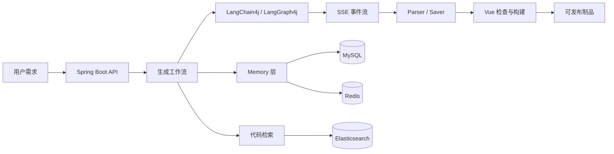

<h1 align="center">
  AI 应用生成与交付平台
</h1>

<p align="center">
  <sub>中文 · <a href="README.en.md">English</a></sub>
</p>

<p align="center">
  <a href="https://github.com/glyahh/ai-generate-code"></a>
  
  
  
  
</p>

<p align="center"><strong>从自然语言到可预览、可修改、可构建、可发布的 Web 应用。</strong></p>

## 项目简介

这是一个基于 Java、Spring Boot、LangChain4j 和 LangGraph4j 的 AI 应用生成平台。

系统接收用户对应用的描述，通过模型和工作流生成项目代码，再经过解析、保存、检索、构建检查和发布，形成可以访问的 Web 应用制品。

项目重点不只是生成代码，还包括生成后的工程问题：多轮对话如何保持项目上下文、用户配置变化后 Memory 如何同步、工具调用如何稳定流式传递，以及生成的 Vue 代码如何经过实际构建验收。

## 核心功能

<table>
<tr><td width="50%" valign="top">

### 流式生成

通过 SSE 返回模型文本、工具请求和工具执行事件，支持普通生成链路和 LangGraph4j 工作流链路。

<a href="docs/engineering-journal/cases/04-streaming-tool-state-machine.md">查看工程记录 →</a>

</td><td width="50%" valign="top">

### 分层会话记忆

MySQL 保存完整历史，Redis 保存模型上下文窗口，并通过摘要和版本机制控制长对话上下文。

<a href="docs/engineering-journal/cases/05-layered-memory-lifecycle.md">查看工程记录 →</a>

</td></tr>
<tr><td width="50%" valign="top">

### 面向项目的代码生成

将已有代码切块写入 Elasticsearch，结合 KNN 和 BM25 检索相关内容，减少重复生成和无关上下文。

<a href="docs/engineering-journal/cases/06-rag-artifact-retrieval.md">查看工程记录 →</a>

</td><td width="50%" valign="top">

### 构建验证

Vue 项目在发布前经过 SFC 解析、问题修复、二次检查和 `npm run build`，构建失败时不会直接发布。

<a href="docs/engineering-journal/cases/07-vue-build-validation.md">查看工程记录 →</a>

</td></tr>
<tr><td width="50%" valign="top">

### 工具调用流

处理 partial / complete 回调、重复事件过滤、空流重试和状态回放，减少模型事件顺序变化对前端状态的影响。

</td><td width="50%" valign="top">

### 可视化编辑

支持在生成页面中选择元素并编辑。iframe 内部注入不稳定时，由父页面接管 hover 和 selected overlay。

<a href="docs/engineering-journal/cases/01-iframe-visual-editor-fallback.md">查看工程记录 →</a>

</td></tr>
<tr><td width="50%" valign="top">

### 个性化配置一致性

用户修改应用风格或回答风格后，同步更新 MySQL、Redis、Memory Version 和缓存中的 `AiService`。

<a href="docs/engineering-journal/cases/02-personalization-memory-consistency.md">查看工程记录 →</a>

</td><td width="50%" valign="top">

### 应用制品交付

生成结果经过解析和保存后，通过 `deployKey` 提供静态资源访问，并支持应用发布与撤回。

</td></tr>
</table>

## 系统架构



## 技术栈

| 层次 | 技术 |
| --- | --- |
| 后端 | Java 21、Spring Boot、Spring Web、Spring AOP |
| AI 编排 | LangChain4j、LangGraph4j、Reactor |
| 存储 | MySQL、Redis、Caffeine、Redisson |
| 检索 | Elasticsearch、KNN、BM25 |
| 前端 | Vue 3、TypeScript、Vite |
| 构建与交付 | Maven、Vue compiler、静态制品发布 |

## 快速开始

运行环境：Java 21、MySQL、Redis 和可用的 OpenAI-Compatible 模型接口。

配置文件：`src/main/resources/application.yml`。请使用本地环境变量或未提交的配置文件保存凭证。

启动后端：

```bash
./mvnw spring-boot:run
```

默认端口为 `8124`，接口前缀为 `/api`。

启动前端：

```bash
cd ai-generate-code-frontend
npm install
npm run dev
```

## 主要接口

| 方法 | 接口 | 说明 |
| --- | --- | --- |
| GET | `/api/chat/gen/code` | 流式代码生成 |
| GET | `/api/chat/gen/workflow` | 工作流代码生成 |
| POST | `/api/app/add` | 创建应用 |
| POST | `/api/app/deploy` | 发布应用 |
| POST | `/api/app/undeploy` | 撤回发布 |
| GET | `/api/static/{deployKey}/**` | 访问发布制品 |

## 工程记录

工程问题和设计取舍记录在 [`docs/engineering-journal/`](docs/engineering-journal/README.md)，包括：

- [iframe 可视化编辑兜底](docs/engineering-journal/cases/01-iframe-visual-editor-fallback.md)
- [个性化配置与 Memory 一致性](docs/engineering-journal/cases/02-personalization-memory-consistency.md)
- [工具流状态机](docs/engineering-journal/cases/04-streaming-tool-state-machine.md)
- [分层 Memory 生命周期](docs/engineering-journal/cases/05-layered-memory-lifecycle.md)
- [代码制品 RAG](docs/engineering-journal/cases/06-rag-artifact-retrieval.md)
- [Vue 构建验证](docs/engineering-journal/cases/07-vue-build-validation.md)

## 当前进展

主要生成、Memory、检索、构建验证和发布链路已经实现。下一步会补充 SSE 和 Memory 自动化测试、线程池与连接池测试、Redis 故障测试、RAG 质量评测和可重复的并发压测脚本。

README 不提供未经实测的吞吐量或生产可用性结论。

## License

MIT
