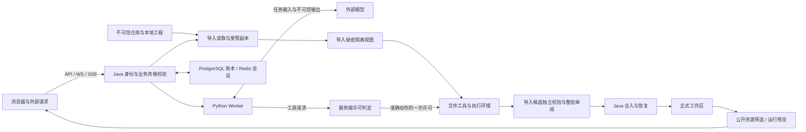

# 应用魔方威胁模型

本文件用于代码安全审查：说明需要保护的资产、攻击者能力、信任边界和应验证的攻击路径。审查执行与报告规范见 [SECURITY.md](../SECURITY.md)，通用审查约束见 [AGENTS.md](../AGENTS.md)。

建立日期：2026-10-27；源码参考：`ac47a62`。本次依据本地源码与已跟踪文档进行静态梳理，未执行漏洞利用、运行时安全验收或线上配置检查。下文“源码观察”只描述已读到的实现，“安全要求”用于检查是否被满足，“威胁场景”不是已确认漏洞。后续审查必须以被审查版本重新核对。

## 1. 范围与前提

覆盖 Vue 前端、Spring Boot API 与实时连接、Java/Python Agent 协议、项目生成与导入、文件编辑与候选合入、Git 凭据、Docker 执行、预览与发布，以及这些流程使用的 PostgreSQL、Redis、文件系统和 CI。

- [当前状态](status/current.md) 顶部是交付范围的权威。已有项目导入的 COMPLETE 结论不延伸到新增会话授权模式；局部实现或局部验证不能证明新增能力已整体验收。
- 平台可以生成和运行用户代码；需要防止的是执行超出授权对象、目录、权限或资源范围。用户在自己获准的沙箱中执行代码，本身不构成漏洞。
- 服务进程、受管辅助程序、数据库和容器管理端属于可信计算基础，但其输入与返回仍须验证。将它们列为可信不代表其实现没有漏洞，也不授予项目代码相同权限。
- 不预设“仅本机运行”“单用户使用”“代理已过滤”“Docker 已隔离”或“公开链接难以猜中”。暴露范围、部署域名、Cookie 属性、代理规则和容器配置需要实际证据。
- 外部模型、仓库内容、依赖包、模型生成代码和工具输出不能授予平台权限。模型服务按应用配置接收输入，但不应获得超出任务需要的秘密；供应商留存与部署网络策略本次未核实。
- 已获得宿主机管理员权限后的任意操作，不作为普通应用漏洞的默认攻击前提；如果当前改动让低权限输入获得该权限，越界过程仍在范围内。平台物理安全和供应商内部系统不在本仓库的直接审查范围内。

## 2. 资产与攻击者

| 资产 | 必须保护的性质 | 主要损失 |
| --- | --- | --- |
| 身份、登录会话、应用与线程归属 | 不能冒用或跨对象使用 | 跨用户读写、伪造批准、接管项目 |
| 源码、未保存编辑、快照与正式工作区 | 完整性、版本一致性、私有性 | 源码泄露、覆盖新编辑、不可恢复的丢失 |
| Git 凭据、模型密钥、秘密文件与恢复映射 | 机密性、用途范围、有效期 | 私库泄露、账户滥用、秘密进入模型或公开制品 |
| 单次许可、候选审阅、编辑与资源账本 | 不可伪造、准确绑定、单次消费 | 重放执行、越权合入、虚假完成、错误清理 |
| 宿主机、Worker、容器、卷及网络 | 权限隔离、可用性、可核对身份 | 宿主机接管、跨应用影响、资源耗尽 |
| 发布内容、预览页面、日志与知识快照 | 公开范围正确、来源与版本可追踪 | 浏览器越权、泄密、陈旧证据误导执行 |
| CI 凭据与检查结果 | 最小权限、确定性门禁 | 不可信 PR 获取秘密、无验证代码进入受保护分支 |

| 攻击者 | 可控制的输入 | 不默认拥有的权限 |
| --- | --- | --- |
| 未登录访问者或恶意网站 | 可达 HTTP/WS 请求、跨站诱导请求、公开页面输入 | 合法会话、私有应用数据、平台内部服务 |
| 已登录低权限用户 | 自己的应用、请求参数、文件内容、并发与重复请求 | 其他用户对象、管理员操作、平台密钥 |
| 恶意工程或依赖维护者 | Git 内容、文件路径与链接、工程配置、脚本、依赖安装行为 | 平台批准、宿主机目录、容器管理端 |
| 受提示注入影响的 Agent 或恶意模型响应 | 工具请求、候选代码、风险理由、结构化输出 | 修改授权账本、取消硬禁止、代表用户批准 |
| 不可信 PR 提交者 | PR 源码、测试、配置与工作流改动 | 仓库秘密、受保护分支写权限、伪造必需检查结果 |

合法用户的误操作、断线重连、并发编辑、超时和重启不是攻击者，但会触发与恶意重放相同的状态边界，也需要检查。

## 3. 数据流与信任边界

图中的隔离视图和候选发布是导入编辑主线；普通生成/编辑另有 `agentauth/` 与沙箱实现，不能据此认定普通应用自动拥有导入项目全部保护。图示为逻辑数据流，不表示当前每条路径均已验收。

| 边界 | 接收方必须核对 |
| --- | --- |
| TB1 浏览器 → Java | 登录、对象归属、操作资格、跨站来源与请求范围；先校验再产生副作用 |
| TB2 导入源 → 受管副本 | 来源与凭据资格、真实路径、文件类型与链接、大小限额；读取阶段不执行工程代码 |
| TB3 Java → Worker / 模型 | 请求身份、协议与大小边界、最小必要内容；响应不能自授权限或自证成功 |
| TB4 工具 → 工作区 / 容器 | 沙箱硬边界、准确动作许可、一次消费、路径与资源限制 |
| TB5 候选 → 正式工作区 | 当前源版本、候选哈希、批准对象、配置与上下文代次、取消状态、整批一致性 |
| TB6 项目产物 → 浏览器 / 公网 | 公开文件范围、敏感内容、实际 origin、iframe 权限与消息来源 |
| TB7 恢复与 CI → 高权限资源 | 原执行身份、可核对的停止结果、受信脚本与最小令牌权限；不能凭名称或外部文本决定权限 |

## 4. 源码观察与验证边界

Java 路径以下均相对于 `src/main/java/com/dbts/glyahhaigeneratecode/`。这些是定位入口，审查时还需追踪调用方与所有相关出口。

| 源码入口 | 本次观察 | 仍需核对 |
| --- | --- | --- |
| [AgentHandshakeInterceptor](../src/main/java/com/dbts/glyahhaigeneratecode/agent/AgentHandshakeInterceptor.java)、[AgentWebSocketHandler](../src/main/java/com/dbts/glyahhaigeneratecode/agent/AgentWebSocketHandler.java) | 握手读取会话用户；处理生成请求时在创建轮次前调用 `requireOwnedApp` | SSE/REST 等入口是否同样保护；会话失效后的长连接资格 |
| [WorkspacePathResolver](../src/main/java/com/dbts/glyahhaigeneratecode/service/support/WorkspacePathResolver.java) | 按路径元素限制目录；存在的目标还核对真实路径 | 所有读写入口是否复用；新建路径祖先、链接替换与检查后使用竞态 |
| [ImportGitNetworkPolicy](../src/main/java/com/dbts/glyahhaigeneratecode/projectimport/ImportGitNetworkPolicy.java) | Git 直连路径有限定主机、公共地址检查与地址固定；关闭重定向、开启 TLS 验证；另有显式本机代理模式 | 调用是否完整应用配置；代理模式的实际转发范围；其他 HTTP 客户端不能借用该结论 |
| [ImportCredentialBroker](../src/main/java/com/dbts/glyahhaigeneratecode/projectimport/ImportCredentialBroker.java) | 回环通道检查能力值、固定请求、仓库地址和资格；不接受带 Origin 的浏览器请求 | 能力值的传递与访问权限、租约撤销竞态、停止回调是否真正退出 |
| [AgentToolPermissionService](../src/main/java/com/dbts/glyahhaigeneratecode/agentauth/AgentToolPermissionService.java) | 普通应用先检查沙箱可写；复核动作哈希；`execute` 不复用同类许可 | 消费端是否原子、过期或取消后能否执行；导入许可的独立实现需单独审查 |
| [secret_free_view.py](../agent/backends/secret_free_view.py)、[secret_free_docker.py](../agent/backends/secret_free_docker.py) | 导入视图处理秘密路径、替换标记、私有恢复状态与编辑资格；文件工具接入许可 | 容器实际挂载、Shell 与文件工具是否一致隔离；未识别秘密与派生文件是否泄露 |
| [ImportAgentPublication](../src/main/java/com/dbts/glyahhaigeneratecode/projectimport/ImportAgentPublication.java) | 同锁检查资格及源摘要，独立读取候选，记录目录移动阶段并恢复；提交后再清理 | 数据库与文件系统之间的崩溃窗口、取消竞态及当前候选批准绑定 |
| [PublicDeployFiles](../src/main/java/com/dbts/glyahhaigeneratecode/service/support/PublicDeployFiles.java) | 按路径与扩展名筛选常规资源，检查目录真实路径，暂存后替换发布目录 | 所有发布入口是否调用；允许扩展名内嵌秘密、旧发布残留和直接文件服务路由 |
| [ImportExecutionSandbox](../src/main/java/com/dbts/glyahhaigeneratecode/projectimport/ImportExecutionSandbox.java)、[import_disk_volume.py](../scripts/import_disk_volume.py) | 导入执行与编辑容器固定 `--network none`、`--read-only`、`--cap-drop ALL`、`--user 65534:65534`；依赖安装与构建显式使用专用 egress 网络 `glyahh-imp-egress` | 实际容器 inspect、egress 网络的出网范围与 DNS 策略 |
| [docker_sandbox.py](../agent/backends/docker_sandbox.py) | 生成容器使用 `--network bridge`、`--cap-drop ALL`、`no-new-privileges`、pids 512、memory 4g、cpus 2；镜像以 uid 1001 运行 | 实际容器 inspect；bridge 可出网属于已知边界 |

下列观察不能被当成已有安全保证：

- [CorsConfig](../src/main/java/com/dbts/glyahhaigeneratecode/config/CorsConfig.java) 使用 `allowedOriginPatterns("*")` 并允许凭据；[AgentWebSocketConfig](../src/main/java/com/dbts/glyahhaigeneratecode/config/AgentWebSocketConfig.java) 同样放开 Origin pattern。需要结合 Cookie 属性、实际域名/代理和端点行为验证跨站路径；不能声称来源已限制，也不能仅凭配置片段宣告攻击已复现。
- [AppChatView.vue](../ai-generate-code-frontend/src/page/App/AppChatView.vue) 分别构造静态与运行预览地址。实际隔离还依赖部署地址、响应头、iframe 配置和编辑桥接，不能用一条预览路径的结果覆盖另一条。
- 本次没有读取本地秘密配置、核对真实数据库版本、Docker 挂载、外网出口或线上会话策略。文档中的默认配置和历史验收不是当前部署证据。

## 5. 重点威胁与最小验证场景

以下 T01–T12 是审查场景编号，不是漏洞编号或修复待办。只在改动涉及相应路径时展开；严重性根据实际可达性和影响确定，不预设全部为 High。

### T01 跨用户对象访问与执行（TB1）

- **路径与影响：** 已登录用户替换 app、thread、run、edit、permission 或 credential 标识，经读取、审批、取消或恢复入口访问其他用户项目，或在拒绝前创建工作区/启动进程。
- **安全要求：** 登录与对象归属分别校验；后台任务、缓存和实时连接保留相同约束，不能只依赖 Controller 注解或前端隐藏按钮。
- **验证：** 用两个测试用户替换各对象标识，检查响应与数据库、文件、进程副作用；覆盖 WS/SSE/REST，以及校验后归属或资格发生变化的情况。

### T02 跨站请求与不可信预览越权（TB1、TB6）

- **路径与影响：** 恶意网站或生成页面借浏览器会话调用平台接口、建立 WS、读取跨源响应，或通过渲染/消息桥接执行平台上下文代码。
- **安全要求：** 分别验证 CORS、Cookie、写操作防跨站措施、WS Origin、HTML/Markdown 渲染及 iframe/消息边界；CORS 不是所有跨站写操作的保护，HttpOnly 也不能阻止脚本代发已认证请求。
- **验证：** 使用独立测试 origin 和无真实数据的会话，记录请求是否携带 Cookie、握手/写操作是否成功及响应可读性；静态预览、运行预览和 `postMessage` 的 source/origin 分别检查。

### T03 路径与链接逃逸（TB2、TB4、TB5）

- **路径与影响：** 恶意文件名、绝对路径、编码、符号链接、junction 或硬链接进入复制、读取、保存、删除、发布或恢复流程，越界读写平台/其他应用文件。
- **安全要求：** 按最终允许根核对真实路径与链接策略；新建文件检查有效祖先；不能把路径正规化、字符串前缀或“不跟随末级链接”当成整条路径的证明。
- **验证：** 在临时目录中设置允许根内外的假文件，测试平台支持的链接类型和检查后替换；断言根外文件未读出、未变化，而不只断言接口报错。

### T04 Git、下载与代理的 SSRF 或凭据错发（TB2）

- **路径与影响：** 攻击者通过来源 URL、重定向、DNS 或代理配置访问内部服务，或让凭据被发送到错误仓库/主机。
- **安全要求：** 校验对象与实际连接一致，TLS 验证和协议限制保持有效；凭据绑定准确远端和租约。受信管理员配置的回环代理与用户控制的代理不是同一种信任。
- **验证：** 采用假解析结果、本地 HTTP 替身与假凭据，覆盖私网/回环/IPv6、混合地址、重定向、错误仓库和过期租约；不探测真实内网或云元数据服务。

### T05 秘密进入模型、工具输出或公开制品（TB2–TB6）

- **路径与影响：** 导入秘密、凭据能力值、环境变量或恢复映射经模型输入、Shell、差异、日志、异常、知识快照或发布文件外泄；允许的 `.js`/`.json` 等也可能包含秘密。
- **安全要求：** 从输入与挂载隔离秘密，输出脱敏仅作为补充；私有映射只供可信恢复端使用。秘密占位符不能被复制到新位置以获得恢复资格，公开发布不等于整个工作区公开。
- **验证：** 使用有唯一标记的假秘密跟踪模型输入、协议、日志、候选与发布目录；覆盖普通与导入应用、二进制/派生文件以及秘密标记移动或替换。

### T06 提示注入与审批绕过（TB3、TB4）

- **路径与影响：** README、依赖输出或模型响应诱导 Agent 读取秘密、执行超范围命令、伪造低风险结论或声称已获批准。
- **安全要求：** 外部文本只作为数据；平台硬边界不随提示词变化。独立无工具风险审查绑定本次对象，不能替代确定性校验，失败不能自动批准。
- **验证：** 用固定模型替身产生越界动作、错误对象哈希、畸形结果和超时，确认无副作用且真实失败可见；不要求模型“保证服从”作为防护证据。

### T07 许可重放、范围扩张与检查后替换（TB4）

- **路径与影响：** 复用已消费票据、并发提交、改变命令/路径/文件内容、跨线程使用同类授权，或借模式切换执行未经许可的动作。
- **安全要求：** 许可绑定身份、准确动作与前置状态，原子消费；同类授权不扩大对象或用途。AUTO 只影响合法操作是否需要人工打断，不能越过沙箱硬边界。
- **验证：** 两次并发消费同一票据、批准后修改脚本、取消后回包、跨应用/会话重用；断言副作用最多一次且作用于原对象。普通应用 `execute` 每次取得独立票据。

### T08 候选篡改与错误合入（TB5）

- **路径与影响：** 批准后更换候选、复用旧哈希、让 Shell 未登记变更混入发布，或用陈旧源覆盖用户新编辑，造成未授权代码落地与数据丢失。
- **安全要求：** Java 独立验证完整候选和批准绑定；实际发布时复核源、配置、上下文代次、取消和有效期；阶段日志与真实目录共同支持恢复。
- **验证：** 在批准与提交之间修改源/候选或取消，在目录移动与数据库提交之间注入故障；验证整批一致性、保留新编辑、错误可恢复且不误报成功。

### T09 沙箱逃逸与资源耗尽（TB4、TB7）

- **路径与影响：** 工程脚本借继承环境、宿主机挂载、Docker socket、特权参数或无限输出/进程/文件突破范围，影响宿主机或其他应用。
- **安全要求：** 管理端权限不传给项目；实际执行环境具有限额与清理身份。容器运行成功、只读工具接口或模型提示词不能证明 Shell 被隔离。
- **验证：** 先检查实际启动参数与挂载；必要时在获准的专用环境做有上限的假负载，确认限额与停止结果。本文件不授权压力测试、宿主机探测或执行逃逸代码。
- **现有入口：** `scripts/checks/verify-sandbox-isolation.ps1` 起容器后 `docker inspect`，由 `scripts/checks/assert-sandbox-inspect.py` 判定网络、只读根、用户、cap-drop、限额与挂载；Docker 不可用时以退出码 3 记为 skip。该入口只核对声明参数，不证明逃逸路径不可行。

### T10 取消、重启和延迟回包导致跨任务副作用（TB3、TB5、TB7）

- **路径与影响：** 旧 Worker 回包污染新会话，重启自动重放未确认动作，PID/容器名复用后停止错误任务，或未停止的进程继续修改已释放工作区。
- **安全要求：** 绑定原任务、原计划版本、代次及真实资源身份；停止未确认时保留账本与占用保护。可信非零退出和执行状态未知按不同流程处理。
- **验证：** 模拟断线、重连、超时、进程停止失败、资源身份变化与旧消息晚到，确认无重复执行/误清理；前端切换应用后旧文件读取和保存不得污染新对象。

### T11 数据库、迁移与协议破坏安全不变量（TB1、TB3、TB5）

- **路径与影响：** SQL 动态拼接、遗漏 owner 条件、丢失更新、审批状态非原子转换、迁移宽松默认值或跨语言 ID 精度损失，造成授权错配、数据破坏或重放。
- **安全要求：** 查询值绑定与标识符限制、事务/唯一约束/条件更新相互配合；ID 跨语言保持 string；终态、取消与错误不能映射为成功；迁移不得提升旧记录权限。
- **验证：** 使用隔离测试库检查并发更新、回滚和存量数据升级；协议替身覆盖大 ID、乱序、重复、畸形帧与取消。脚本存在不等于迁移已经执行。

### T12 PR、依赖与验证结果被滥用（TB7）

- **路径与影响：** 不可信 PR 或依赖安装脚本获取 CI/平台秘密，修改测试与报告检查制造成功，或引入实际可达的依赖漏洞。
- **安全要求：** CI 令牌与秘密最小化；不可信代码不能借高权限触发方式执行；`merge-gate` 依赖确定性结果，真实 case 缺失、失败或有效测试被跳过不能变绿。
- **验证：** 对照 [.github/workflows/pr-checks.yml](../.github/workflows/pr-checks.yml) 和报告检查脚本，审查触发事件、令牌权限、依赖变更与 job 选择；依赖问题需核实版本和调用路径，不仅引用扫描告警标题。

## 6. 验证入口与尚未验证的事项

以下是已有测试入口，不代表本次执行通过；测试标签、环境需求和实际覆盖以测试源码为准，不为文档任务启动服务或扩大测试范围。

| 威胁 | 现有验证入口 |
| --- | --- |
| T01 | `AgentOwnershipBeforeWriteTest`、`ImportCredentialControllerTest` |
| T03 / T05 | `WorkspacePathResolverTest`、`PublicDeployFilesTest`、`ImportSourcePublicationGateTest`、`agent/tests/test_secret_free_view.py`、`agent/tests/test_secret_free_docker.py` |
| T04 | `ImportGitNetworkPolicyTest`、`ImportCredentialBrokerTest` |
| T07 | `AgentExecutePermissionRegressionTest`、`AgentPermissionGateJdbcTest`、`ImportAgentPermissionJdbcTest` |
| T08 / T10 | `ImportAgentCandidateVerifierTest`、`ImportAgentPublicationTest`、`ImportAgentEditRecoveryTest`、`ImportExecutionRunnerTest` |
| T10 / T11 | `agentStreamTransport.test.ts`、`ProjectFilesModal.test.ts`、`agent/tests/test_stream_completion_regression.py`、[防复发映射](ci/regression-inventory.md) |

T02 的实际跨站链路、T09 的运行时隔离和 T12 的远端仓库权限需要部署或 CI 证据；T06 的完整提示注入链路也不能仅靠工具层单测证明。其他条目同样没有因列出测试名称而完成安全验证。

发现记录应包含：被审查版本与准确 `path:line`、攻击者能力、入口与控制数据、跨越的边界编号、现有保护如何失效、实际影响、静态推导或复现证据、最小修复和防复发场景。置信度与严重性遵守 [SECURITY.md](../SECURITY.md)，不把未知条件当成已满足，也不把没有发现写成全面安全证明。

## 7. 维护规则

- 当身份/会话、来源支持、凭据、许可模式、候选合入、执行环境、预览域名、公开发布、数据库或 CI 信任边界发生变化时，同步更新对应边界、攻击路径和验证入口。
- 保留威胁编号便于关联发现与回归测试；新增场景不自动成为已确认缺陷，不恢复用户已移出当前交付范围的旧需求。
- 历史保护被修改或移除时，记录新的实际机制与依据；不要把本文件当作绕过测试、读取秘密、执行外部脚本或自动接受降级的授权。

相关契约：[Java ↔ Python](contracts/agent.md)、[导入授权方案](plans/import-agent-permission-modes-plan.md)、[PR 审查与 CI](ci/pr-review-policy.md)。
